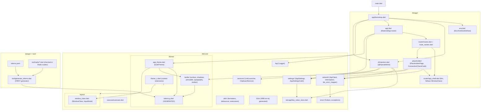
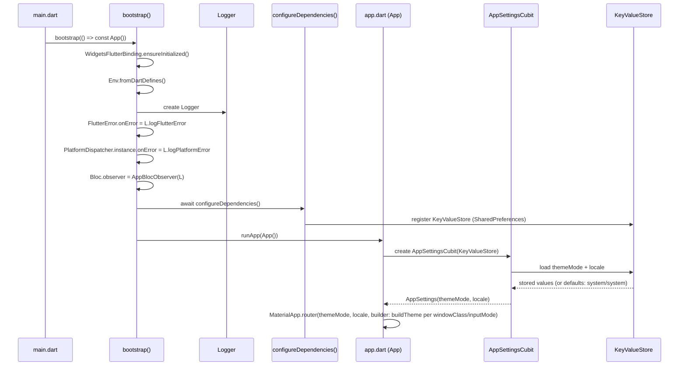
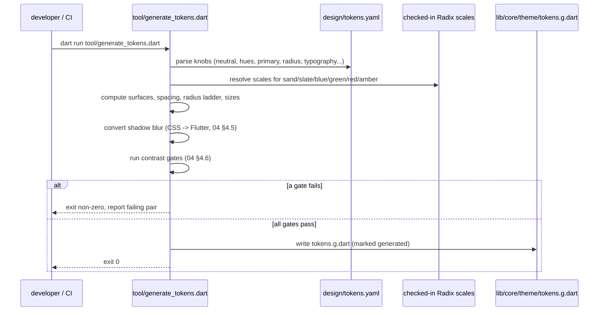

# Design Document: skeleton-foundation

## Overview

This spec builds the foundation layer of the `skeleton/` Flutter project: the Clean Architecture +
BLoC, feature-first base that every generated app starts from. It produces a project that `flutter create`
can scaffold for all six platforms, with the pinned packages wired up (`03` §2), the platform setup that
lets release builds reach the network (`03` §5), the `lib/app/` bootstrap and DI/router wiring, the
`lib/core/` infrastructure (error, usecase, network, storage, services, settings, utils, l10n), and the
**tactile-design** visual foundation (surfaces, shadows, pressable, typography, motion, theme mapping) with
its `design/tokens.yaml` knobs and a first token generator script that writes `lib/core/theme/tokens.g.dart`.

The foundation exists to satisfy success criterion 1 of `00-overview.md`: a generated app runs on web,
Android, iOS, and macOS, passes `flutter analyze` and `flutter test`. It also delivers the settings model
the whole system depends on: theme mode `System | Light | Dark` with **System as the default**, and locale
`System | en | id`, both saved across restarts through a `KeyValueStore`, with both apps following the device
until the user picks a theme.

This design combines a high-level view (component diagram, architecture, data models, interface contracts)
with a low-level view (key class and function signatures, the token generator algorithm, the blur
conversion, error handling). Code is written in **Dart**, the project's language per `03` §2. Pinned package
versions are decided during implementation (latest stable at project start) and recorded in
`skeleton/README.md` (`03` §2); this document does not fix version numbers.

### What is in scope

Everything named in the starter prompt (`11` Phase 1, `skeleton-foundation`): `flutter create` with all
platforms and the foundation packages; platform setup; `lib/app/`; `lib/core/` foundation (error, usecase,
network, storage, services, settings, utils, l10n); `design/tokens.yaml` plus the first token generator;
the tactile foundation in `lib/core/theme/tactile/`; `lib/core/layout/` window-class and input-mode
plumbing; branding placeholders, native splash, and web loading screen; and a **placeholder page** (temporary
theme/locale controls and a "Check connection" button) so the acceptance criteria can be run by hand.

### What is explicitly out of scope (deferred)

- **Core widgets** beyond the tactile primitives (`TactileSurface`, `Pressable`): `AppButton`, `AppCard`,
  `AppRow`, `EmptyState`, `ErrorView`, `LoadingView`, the adaptive layout widgets (`AdaptiveScaffold`,
  `PageColumn`, `AdaptiveGrid`, `AdaptiveBuilder`, `ActionGroup`), etc. — owned by `core-widgets-and-templates`.
- The stress-test harness, goldens, accessibility matchers (`test/helpers/stress.dart`).
- Mason bricks, `tool/create_app.dart`, `tool/sync_core.dart`.
- The `kit` CLI. The token generator here is a deliberate stand-in that `kit tokens` replaces in Phase 2.
- Kiro hooks, skills, steering, agents.
- The `home` example feature.

These are referenced only where the foundation must leave a seam for them (notably `app_shell.dart` wiring and the
temporary controls on the placeholder page, which `ThemeModeSwitch` replaces).

---

## Architecture

### Layer model and dependency rules (`03` §3)

```
presentation ──► domain ◄── data
      │                       │
      └────────► core ◄───────┘
```

| Layer | May import | Must not import |
|---|---|---|
| `domain/` | `core/error`, `core/usecase`, `fpdart`, `freezed_annotation`, `meta` | Flutter, dio, json, `data/`, `presentation/`, other features |
| `data/` | own `domain/`, `core/*` (not `core/widgets`, `core/theme`, `core/layout`), dio, json | `presentation/`, other features |
| `presentation/` | own `domain/`, `core/*`, Flutter | own `data/`, other features, Material visual widgets (TAC001) |
| `core/` | Flutter, packages | any `features/*` |
| `app/` | everything | — |

This spec creates `app/` and `core/`; it creates no feature, so the feature dependency rules are honored
only by leaving them unviolated (core never imports `features/`).

### Component diagram



Key relationships:

- `main.dart` calls `bootstrap()`, which configures bindings, DI, the `Bloc.observer`, and routes both Flutter
  error channels to the core `Logger`, then runs the app.
- `app.dart` builds `MaterialApp.router`. `themeMode` and `locale` come from `AppSettingsCubit`;
  `MaterialApp.router(builder:)` rebuilds the theme via `buildTheme(brightness, windowClass, inputMode)`
  whenever the window class or input mode changes (`04` §9).
- `AppSettingsCubit` reads and writes `AppSettings` through `KeyValueStore` (over `shared_preferences`).
- The theme reads only generated tokens and tactile helpers. No raw color/shadow/size/font literals exist
  outside `core/theme/` (UI001–UI004, TAC002–TAC005).
- The token generator is an offline build step (a Dart script), not part of the running app. It reads
  `design/tokens.yaml` plus checked-in Radix color data and writes `lib/core/theme/tokens.g.dart`.

### Boot sequence



### Token generation sequence (build-time, offline)



---

## Directory and file layout created by this spec

Only files this spec owns are listed. Files owned by later specs are marked `(later spec)` and created as a
minimal seam only where boot requires it.

```
skeleton/
├── pubspec.yaml                         # foundation packages pinned in Phase 1
├── analysis_options.yaml                # very_good_analysis + project tweaks
├── .fvmrc                               # Flutter 3.44.8 (in skeleton/, copied by create_app)
├── pubspec.lock                         # committed (skeleton only)
├── README.md                            # how to use the skeleton + pinned versions table + deviations
├── env/
│   └── example.json                     # committed; FLAVOR, API_BASE_URL, HEALTH_URL
├── design/
│   └── tokens.yaml                      # tactile knobs (04 §4.1)
├── tool/
│   ├── generate_tokens.dart             # FIRST token generator (stand-in for kit tokens)
│   └── radix/
│       ├── fetch_scales.dart            # one-shot fetch of light.ts/dark.ts at radix-ui/colors dbdb854 (no new dependency)
│       ├── radix_scales.dart            # GENERATED by fetch_scales.dart, checked in (sand, slate, blue, green, red, amber)
│       └── README.md                    # source commit + licence note
├── assets/
│   ├── fonts/                           # Inter-Medium.ttf (registered); Space Grotesk, Plus Jakarta Sans (present, not registered)
│   └── branding/
│       ├── icon.png                     # 1024 placeholder
│       ├── icon_foreground.png          # placeholder
│       ├── splash.png                   # placeholder
│       └── og.png                       # placeholder
├── web/
│   └── index.html                       # title, description, favicon, OG image, loading screen (native_splash)
├── android/app/src/main/AndroidManifest.xml   # INTERNET permission (+ https <queries> if canLaunchUrl used)
├── ios/                                 # nothing extra for HTTPS
├── macos/Runner/
│   ├── DebugProfile.entitlements        # com.apple.security.network.client = true
│   └── Release.entitlements             # com.apple.security.network.client = true
├── windows/ linux/                      # from flutter create
└── lib/
    ├── main.dart                        # calls bootstrap()
    ├── app/
    │   ├── app.dart                     # App: MaterialApp.router
    │   ├── bootstrap.dart               # bootstrap(): bindings, DI, observer, error handlers
    │   ├── env.dart                     # Env, Env.fromDartDefines()
    │   ├── app_bloc_observer.dart       # AppBlocObserver -> Logger
    │   ├── placeholder/
    │   │   ├── placeholder_page.dart    # temporary controls + Check connection (seams for ThemeModeSwitch)
    │   │   ├── connection_check_cubit.dart # idle | loading | success | failure(Failure)
    │   │   └── connection_check_state.dart # freezed state
    │   ├── di/
    │   │   ├── injection.dart           # @InjectableInit configureDependencies() + resetDependencies() for tests
    │   │   ├── injection.config.dart    # GENERATED by injectable_generator, committed
    │   │   └── register_module.dart     # @module third-party registrations (SharedPreferences, Dio)
    │   └── router/
    │       ├── routes.dart              # the ONLY place GoRoute is declared
    │       ├── route_names.dart         # route name constants
    │       └── app_shell.dart           # thin shell following WindowClass (AdaptiveScaffold owned later)
    └── core/
        ├── error/
        │   ├── failure.dart             # sealed Failure hierarchy (freezed)
        │   └── exceptions.dart          # *Exception types thrown by data sources
        ├── usecase/
        │   └── usecase.dart             # UseCase<Type, Params>, NoParams
        ├── log/
        │   └── logger.dart              # Logger (core logging sink)
        ├── network/
        │   ├── api_client.dart          # ApiClient: single Dio client
        │   ├── dio_error_mapper.dart    # guardRepository(), DioException -> Failure
        │   └── interceptors/
        │       └── auth_interceptor.dart# no-op auth interceptor (extension point)
        ├── storage/
        │   └── key_value_store.dart     # KeyValueStore interface + SharedPreferences impl
        ├── services/
        │   ├── link_launcher.dart       # LinkLauncher over url_launcher
        │   └── clipboard_service.dart   # ClipboardService
        ├── settings/
        │   ├── app_settings.dart        # AppSettings (freezed), AppThemeMode, AppLocale
        │   └── app_settings_cubit.dart  # AppSettingsCubit
        ├── utils/
        │   ├── formatters.dart          # date/number/money/compact formatters (intl)
        │   ├── debouncer.dart           # Debouncer
        │   └── extensions.dart          # small BuildContext/other extensions
        ├── l10n/
        │   ├── app_en.arb               # English strings (foundation-level)
        │   ├── app_id.arb               # Indonesian strings
        │   └── app_localizations.dart   # GENERATED (gen-l10n)
        ├── theme/
        │   ├── tokens.g.dart            # GENERATED by tool/generate_tokens.dart
        │   ├── app_theme.dart           # buildTheme(brightness, windowClass, inputMode)
        │   ├── theme_x.dart             # context.surface/text/sizes/hue()/reduceMotion
        │   └── tactile/
        │       ├── surface.dart         # SurfaceKind, SurfaceScope, TactileSurface (04 §5)
        │       ├── shadows.dart         # recipe -> List<BoxShadow> (blur conversion 04 §4.5)
        │       ├── pressable.dart       # Pressable (press scale, hover/pressed fill, focus ring, 48 hit area)
        │       ├── typography.dart      # AppTypography ThemeExtension (04 §6)
        │       └── motion.dart          # AppMotion, AppSprings, page transition builder, reduced motion
        └── layout/
            └── window_class.dart        # WindowClass, InputMode, context extensions
```

**Generated-file policy (Q10).** Committed: `pubspec.lock` (skeleton only), `tokens.g.dart`, `radix_scales.dart`,
`injection.config.dart`, and the `gen-l10n` output. Not committed (ignored): `*.freezed.dart`, so a fresh clone runs
`dart run build_runner build -d` before analyzing. `README.md` states this.

Generated files are marked with a header and never hand-edited: `tokens.g.dart`, `injection.config.dart`,
`app_localizations.dart`.

`.gitignore` rules this spec must respect (`02`): must NOT ignore `.kiro/` or `lib/core/theme/tokens.g.dart`;
must ignore `.dart_tool/kit/` and `test/**/failures/`. (The latter two are created by later specs; the
foundation only avoids re-ignoring the protected paths that `flutter create` might add.)

---

## Data Models

### Env (`app/env.dart`)

Immutable configuration read from `--dart-define`s. No secrets in code (`03` §5).

```dart
@immutable
class Env {
  const Env({
    required this.flavor,
    required this.apiBaseUrl,
    required this.healthUrl,
  });

  /// Reads all values from compile-time --dart-define / --dart-define-from-file.
  factory Env.fromDartDefines() => Env(
        flavor: const String.fromEnvironment('FLAVOR', defaultValue: 'dev'),
        apiBaseUrl: const String.fromEnvironment('API_BASE_URL'),
        healthUrl: const String.fromEnvironment('HEALTH_URL', defaultValue: 'https://example.com'),
      );

  final String flavor;
  final String apiBaseUrl;

  /// Target of the placeholder page's "Check connection" button. Absolute URL.
  final String healthUrl;

  bool get isProd => flavor == 'prod';
}
```

`env/example.json` documents the keys (`FLAVOR`, `API_BASE_URL`, `HEALTH_URL`) and is committed. Apps pass
`--dart-define-from-file=env/<flavor>.json`.

### AppSettings (`core/settings/app_settings.dart`)

The user-facing settings model. `freezed`, no JSON annotations (it is persisted field-by-field through
`KeyValueStore`, not as JSON, so there is one source of truth for keys).

```dart
enum AppThemeMode { system, light, dark } // DEFAULT: system
enum AppLocale { system, en, id }          // DEFAULT: system

@freezed
class AppSettings with _$AppSettings {
  const factory AppSettings({
    @Default(AppThemeMode.system) AppThemeMode themeMode,
    @Default(AppLocale.system) AppLocale locale,
  }) = _AppSettings;

  const AppSettings._();

  /// Maps to Flutter's ThemeMode for MaterialApp.themeMode.
  ThemeMode get flutterThemeMode => switch (themeMode) {
        AppThemeMode.system => ThemeMode.system,
        AppThemeMode.light => ThemeMode.light,
        AppThemeMode.dark => ThemeMode.dark,
      };

  /// null => MaterialApp follows the device locale (system).
  Locale? get flutterLocale => switch (locale) {
        AppLocale.system => null,
        AppLocale.en => const Locale('en'),
        AppLocale.id => const Locale('id'),
      };
}
```

Persistence: enums are stored by `name` string under stable keys. Unknown or missing values fall back to
`system` (the default), which is how both apps follow the device until the user picks a value.

| Key | Type | Default | Meaning |
|---|---|---|---|
| `settings.themeMode` | String (`system`/`light`/`dark`) | `system` | `AppThemeMode` |
| `settings.locale` | String (`system`/`en`/`id`) | `system` | `AppLocale` |

### Failure hierarchy (`core/error/failure.dart`)

Sealed `Failure` for the domain contract `Either<Failure, T>`. `freezed` sealed union; each variant carries
an optional developer message and keeps a mapping target for localized two-line display (`ErrorView` in a
later spec maps each subtype).

```dart
@freezed
sealed class Failure with _$Failure {
  const Failure._();

  /// No connectivity / socket / timeout reaching the server.
  const factory Failure.network({String? message}) = NetworkFailure;

  /// Server returned an error status (4xx/5xx). [statusCode] when known.
  const factory Failure.server({int? statusCode, String? message}) = ServerFailure;

  /// Request was understood but rejected (validation, 422), with field errors.
  const factory Failure.validation({
    Map<String, String>? fieldErrors,
    String? message,
  }) = ValidationFailure;

  /// Authentication/authorization required or denied (401/403).
  /// Present as an extension point even though the skeleton ships no auth.
  const factory Failure.unauthorized({String? message}) = UnauthorizedFailure;

  /// Requested resource not found (404).
  const factory Failure.notFound({String? message}) = NotFoundFailure;

  /// Local cache / key-value / parse failure.
  const factory Failure.cache({String? message}) = CacheFailure;

  /// Anything unmapped. Always has a developer message in the log.
  const factory Failure.unexpected({String? message}) = UnexpectedFailure;
}
```

### Exceptions (`core/error/exceptions.dart`)

Thrown by data sources; never cross into domain. `guardRepository` maps them (and `DioException`) to
`Failure`.

```dart
sealed class AppException implements Exception {
  const AppException([this.message]);
  final String? message;
}

class ServerException extends AppException {
  const ServerException({this.statusCode, String? message}) : super(message);
  final int? statusCode;
}
class NetworkException extends AppException { const NetworkException([super.message]); }
class ValidationException extends AppException {
  const ValidationException({this.fieldErrors, String? message}) : super(message);
  final Map<String, String>? fieldErrors;
}
class UnauthorizedException extends AppException { const UnauthorizedException([super.message]); }
class NotFoundException extends AppException { const NotFoundException([super.message]); }
class CacheException extends AppException { const CacheException([super.message]); }
```

### Token data shapes

#### `design/tokens.yaml` (input, `04` §4.1)

The checked-in knobs. Only brand decisions are configurable; everything else is the tactile system and
stays fixed unless `overrides` names it. The skeleton default:

```yaml
version: 2
language: tactile-design@30495a2
neutral: sand
surface_top: "#ffffff"
hues:
  accent: blue
  success: green
  danger: red
  warning: amber
  info: blue
  identity: []   # empty in Phase 1: only six scales are checked in; `kit tokens` adds identity hues (Q17)
primary: neutral
typography:
  sans: { family: Inter, files: [assets/fonts/Inter-Medium.ttf], weight: 500 }
  heading: null
  mono: null
  size_factor: 1.0
  tracking: { label: -0.01, display: -0.02 }
radius_control: 6
contrast:
  tune_faint_text: true
overrides: {}
```

#### Checked-in Radix scales (`tool/radix/radix_scales.dart`)

The first generator ships only the scales it needs (sand, slate, blue, green, red, amber). The data is
**produced by `tool/radix/fetch_scales.dart`**, a one-shot script (no new dependency, `dart:io` HTTP client) that
reads `light.ts` and `dark.ts` of `radix-ui/colors` at commit `dbdb854` and writes `radix_scales.dart`; both the
script and its output are checked in, and `THIRD_PARTY_NOTICES.md` credits Radix Colors (MIT) with the commit (Q3). `kit` later generates the full `radix_colors.g.dart` from
the upstream source; this file is the stand-in. **No color value is typed into application code**; they live
here as data.

```dart
/// Checked-in Radix color scales for the first token generator.
/// GENERATED by tool/radix/fetch_scales.dart from radix-ui/colors@dbdb854 (src/light.ts, src/dark.ts), MIT.
/// Each scale has 12 steps (index 0 => step 1 ... index 11 => step 12), plus alpha steps a3/a4.
class RadixScale {
  const RadixScale({
    required this.name,
    required this.light,   // 12 hex strings "#rrggbb"
    required this.dark,    // 12 hex strings
    required this.lightAlpha, // {a3, a4} as "#rrggbbaa"
    required this.darkAlpha,
  });
  final String name;
  final List<String> light;
  final List<String> dark;
  final Map<String, String> lightAlpha;
  final Map<String, String> darkAlpha;
}

const radixScales = <String, RadixScale>{
  'sand':  RadixScale(/* ... 12 light, 12 dark, a3/a4 ... */),
  'slate': RadixScale(/* ... */),
  'blue':  RadixScale(/* ... */),
  'green': RadixScale(/* ... */),
  'red':   RadixScale(/* ... */),
  'amber': RadixScale(/* ... */),
};
```

#### `lib/core/theme/tokens.g.dart` (output)

Generated, never hand-edited. Exposes the token groups from `04` §4.2 as `const` Dart. Shape (abridged):

```dart
// GENERATED by tool/generate_tokens.dart from design/tokens.yaml. Do not edit.
// language: tactile-design@30495a2

/// One brightness-specific ink ramp + surface fills + resolved shadows.
class AppPalette {
  const AppPalette({
    required this.ink,          // 12 Color values, index 0 => ink-1
    required this.alphaA3,
    required this.alphaA4,
    required this.ground,
    required this.panel,
    required this.raised,
    required this.overlay,
    required this.well,
    required this.primaryBg,
    required this.primaryFg,
    required this.primaryHover,
    required this.hues,         // Map<HueRole, HueScale>
    required this.identity,     // List<HueScale>
  });
  final List<Color> ink;
  // ... as above
  Color inkStep(int step) => ink[step - 1]; // 1-based accessor

  static const AppPalette light = AppPalette(/* generated */);
  static const AppPalette dark = AppPalette(/* generated */);
}

class HueScale {
  const HueScale({required this.s3, required this.s4, required this.s6,
    required this.s9, required this.s10, required this.s11, required this.s12,
    required this.contrast});
  final Color s3, s4, s6, s9, s10, s11, s12, contrast;
}

enum HueRole { accent, success, danger, warning, info }

/// Spacing ladder 2..64.
abstract final class AppSpace {
  static const double s2 = 2, s4 = 4, s6 = 6, s8 = 8, s12 = 12,
      s16 = 16, s20 = 20, s24 = 24, s32 = 32, s48 = 48, s64 = 64;
}

/// Radius ladder derived from radius_control (c).
abstract final class AppRadius {
  static const double xs = /* c/2 */, sm = /* c-2 */, control = /* c */,
      container = /* c+2 */, feature = /* container*1.5 */, sheet = 14;
  static const Radius full = Radius.circular(9999);
  static const BorderRadius controlAll = BorderRadius.all(Radius.circular(control));
  static const BorderRadius containerAll = BorderRadius.all(Radius.circular(container));
}

abstract final class AppStroke {
  static const double hairline = 0.5, focusRing = 2, focusOffset = 2, mark = 1.5;
}

/// Sizes that depend on input mode are provided as a pair (pointer, touch).
class AppSizeSet {
  const AppSizeSet({required this.control, required this.compact, required this.pill,
    required this.inline, required this.iconButton, required this.badge,
    required this.row, required this.sheetRow, required this.toggleTrack});
  final double control, compact, pill, inline, iconButton, badge, row, sheetRow, toggleTrack;
  static const AppSizeSet pointer = AppSizeSet(/* desktop sizes */);
  static const AppSizeSet touch = AppSizeSet(/* mobile/touch sizes */);
}

abstract final class AppLayout {
  static const double breakpointTablet = 768, breakpointDesktop = 1200;
  static const double colReading = 800, colData = 1200, colForm = 440;
  static const double railExpanded = 256, railCollapsed = 72;
  static const double topStrip = 52, mobileTopBar = 56, panelFloat = 8;
}

/// Shadow recipes resolved to BoxShadow lists, per surface and brightness.
class AppShadows {
  const AppShadows({required this.button, required this.primary, required this.toggle,
    required this.card, required this.table, required this.panel, required this.menu,
    required this.popover, required this.modal, required this.badge});
  final List<BoxShadow> button, primary, toggle, card, table, panel, menu, popover, modal, badge;
  static const AppShadows light = AppShadows(/* generated, blur-converted */);
  static const AppShadows dark = AppShadows(/* generated */);
}
```

Typography, motion, and the window/layout breakpoints are consumed through `AppTypography`, `AppMotion`,
and the `WindowClass` plumbing respectively (below); the generator emits the numeric inputs they need.

---

## Components and Interfaces

### `app/bootstrap.dart`

**Purpose**: single entry that initializes bindings, environment, DI, the bloc observer, and both error
channels before running the app.

```dart
/// Initializes the app and runs it inside a guarded zone.
/// Routes FlutterError.onError and PlatformDispatcher.instance.onError to [Logger].
Future<void> bootstrap(FutureOr<Widget> Function() builder) async {
  WidgetsFlutterBinding.ensureInitialized();

  final env = Env.fromDartDefines();
  final logger = Logger(env: env);

  FlutterError.onError = (details) => logger.logFlutterError(details);
  PlatformDispatcher.instance.onError = (error, stack) {
    logger.logError(error, stack);
    return true;
  };

  Bloc.observer = AppBlocObserver(logger);

  await configureDependencies(); // get_it + injectable

  runApp(await builder());
}
```

`main.dart`:

```dart
void main() => bootstrap(() => const App());
```

`app_bloc_observer.dart`:

```dart
class AppBlocObserver extends BlocObserver {
  const AppBlocObserver(this._logger);
  final Logger _logger;
  @override
  void onError(BlocBase<dynamic> bloc, Object error, StackTrace stackTrace) {
    _logger.logError(error, stackTrace, context: bloc.runtimeType.toString());
    super.onError(bloc, error, stackTrace);
  }
}
```

### `core/log/logger.dart`

**Purpose**: the one logging sink the error handlers and observer route to. Kept minimal; apps may expand it.
It lives in `core/log/` (a small deviation from `03` §4, recorded in `README.md`, Q11). Because `debugPrint` is not
stripped in release builds, `Logger` passes every message through a `redact()` function that masks `Authorization`
header values, bearer tokens, and `password`/`token` fields (Q6).

```dart
@lazySingleton
class Logger {
  Logger({Env? env}) : _env = env;
  final Env? _env;

  void logError(Object error, StackTrace? stack, {String? context}) { /* debugPrint / dev.log */ }
  void logFlutterError(FlutterErrorDetails details) { /* forwards to logError */ }
  void logInfo(String message) { /* ... */ }
}
```

### `app/di/injection.dart` and `register_module.dart`

**Purpose**: DI root. `@InjectableInit` generates `configureDependencies()` into `injection.config.dart`.

```dart
// injection.dart
final getIt = GetIt.instance;

@InjectableInit()
Future<void> configureDependencies() async => getIt.init();

/// Test helper: resets GetIt so configureDependencies() can run again (Q12).
Future<void> resetDependencies() => getIt.reset();
```

```dart
// register_module.dart — third-party async singletons
@module
abstract class RegisterModule {
  @preResolve
  Future<SharedPreferences> get sharedPreferences => SharedPreferences.getInstance();

  @lazySingleton
  Dio dio(Env env) => Dio(BaseOptions(baseUrl: env.apiBaseUrl));

  @lazySingleton
  Env get env => Env.fromDartDefines();
}
```

DI annotations follow `03` §5: `@lazySingleton` for clients, data sources, repositories; `@injectable` for
usecases and blocs. The foundation registers `Logger`, `Env`, `SharedPreferences`, `Dio`, `ApiClient`,
`KeyValueStore`, `LinkLauncher`, `ClipboardService`.

### `app/router/` (routes, route_names, app_shell)

**Purpose**: all routing in one place. `routes.dart` is the only file that declares `GoRoute` (`03` §4).
Cross-feature navigation uses names from `route_names.dart`, never imports.

```dart
// route_names.dart
abstract final class RouteNames {
  static const String root = '/';
  // feature routes added by feature specs
}

// routes.dart — the ONLY place GoRoute is declared
GoRouter buildRouter() => GoRouter(
      initialLocation: RouteNames.root,
      routes: [
        ShellRoute(
          builder: (context, state, child) => AppShell(child: child),
          routes: [
            GoRoute(path: RouteNames.root, builder: (_, __) => const PlaceholderPage()),
          ],
        ),
      ],
    );
```

`app_shell.dart` — **thin shell, decided in Q1 (option A)**. The real `AdaptiveScaffold` (rail/panel/tab bar,
`04` §7) is owned by `core-widgets-and-templates`. The foundation ships a thin `AppShell` that renders its child
inside a `Scaffold`. "Adaptive" in this spec means only that the theme and sizes follow `WindowClass`/`InputMode`
(rebuilt in `app.dart`'s `builder:`); there is no rail, tab bar, or floating panel. A
`// TODO(core-widgets-and-templates): replace with AdaptiveScaffold` marks the seam.

```dart
/// Thin shell. Theme and sizes follow WindowClass via app.dart. Replaced by AdaptiveScaffold in a later spec.
class AppShell extends StatelessWidget {
  const AppShell({required this.child, super.key});
  final Widget child;
  @override
  Widget build(BuildContext context) => Scaffold(body: SafeArea(child: child));
}
```

### `app/placeholder/` (Q2, Q4)

**Purpose**: a temporary root page so the Phase 1 acceptance can be exercised by hand. It is **not** a feature
(no `lib/features/`), and a later spec replaces its controls.

- `PlaceholderPage` shows a title, two groups of temporary controls, and the "Check connection" button.
- **Theme and locale controls**: three buttons System / Light / Dark and three for System / English / Indonesia.
  Each is a `Pressable` over a `TactileSurface` (kind `raised`), calling `AppSettingsCubit.setThemeMode` /
  `setLocale`. The selected one uses `SurfaceScope.selectedFill`. Each group carries
  `// SEAM(core-widgets-and-templates): replace with ThemeModeSwitch`. No Material `SegmentedButton`.
- **Check connection**: a `Pressable` button. `ConnectionCheckCubit.check()` emits `loading`, then calls
  `guardRepository(() => apiClient.get(env.healthUrl))`. `ApiClient.get` accepts an absolute URL, which overrides
  `baseUrl`. The cubit emits `success` on `Right` and `failure(Failure)` on `Left`. While `loading`, the button
  has `onPressed: null` (disabled) and shows the localized loading label ending in "…"; `check()` ignores a
  call made while loading, so a double tap sends one request. The page shows the success message or the
  localized message of the `Failure` subtype.
- The cubit is `@injectable`, takes `ApiClient` and `Env`, and logs the `Failure` through `Logger`.

### `app/app.dart`

**Purpose**: `MaterialApp.router` wired to settings and the per-window-class theme.

```dart
class App extends StatelessWidget {
  const App({super.key});
  @override
  Widget build(BuildContext context) {
    return BlocProvider(
      create: (_) => getIt<AppSettingsCubit>()..load(),
      child: BlocBuilder<AppSettingsCubit, AppSettings>(
        builder: (context, settings) {
          final router = buildRouter();
          return MaterialApp.router(
            routerConfig: router,
            themeMode: settings.flutterThemeMode,
            locale: settings.flutterLocale, // null => follow device
            supportedLocales: AppLocalizations.supportedLocales,
            localizationsDelegates: AppLocalizations.localizationsDelegates,
            // Theme rebuilt per window class + input mode.
            builder: (context, child) {
              final wc = WindowClass.of(context);
              final mode = InputMode.of(context);
              return Theme(
                data: buildTheme(Brightness.light, wc, mode),
                child: child!, // dark handled via darkTheme below
              );
            },
            theme: null,     // supplied by builder for the active window class
            darkTheme: null, // see note
          );
        },
      ),
    );
  }
}
```

> Implementation note: `MaterialApp.router` picks `theme`/`darkTheme` by `themeMode`, but those are built
> before `MediaQuery` is available, so window-class/input-mode-dependent values must be applied in `builder:`.
> The design keeps both light and dark themes derived from `buildTheme(brightness, wc, mode)` and selects the
> brightness inside the builder from `MediaQuery.platformBrightnessOf(context)` combined with
> `settings.themeMode`. The implementer resolves the exact wiring; the contract is: **theme is rebuilt when
> window class or input mode changes, and reflects System/Light/Dark**.

### `core/usecase/usecase.dart`

```dart
abstract class UseCase<Type, Params> {
  Future<Either<Failure, Type>> call(Params params);
}

@immutable
class NoParams {
  const NoParams();
}
```

### `core/network/api_client.dart`

**Purpose**: the single Dio client for the app, with the no-op auth interceptor installed as the extension
point.

```dart
@lazySingleton
class ApiClient {
  ApiClient(this._dio) {
    _dio.interceptors.add(AuthInterceptor()); // no-op extension point
  }
  final Dio _dio;

  Future<Response<T>> get<T>(String path, {Map<String, dynamic>? query}) =>
      _dio.get<T>(path, queryParameters: query);
  // post/put/delete as needed by apps; kept minimal here
}
```

`interceptors/auth_interceptor.dart` — documented no-op; auth is out of scope for the skeleton (`00`
non-goals). The seam is explicit so an app can add token handling later.

```dart
/// No-op auth interceptor. Extension point: attach tokens / refresh here.
/// The skeleton ships no auth (see 00-overview non-goals).
class AuthInterceptor extends Interceptor {
  const AuthInterceptor();
  // onRequest/onError left as pass-through overrides with TODO markers.
}
```

### `core/network/dio_error_mapper.dart`

**Purpose**: `guardRepository` runs a data-source call and maps thrown exceptions (including `DioException`)
to a `Failure`, returning `Either`. Repository impls wrap every call with it (`03` §5).

```dart
/// Runs [body], mapping any thrown exception to a [Failure].
/// Data sources throw *Exception / DioException; this is the one place they
/// become Failure, so repositories return Either<Failure, T> without try/catch.
Future<Either<Failure, T>> guardRepository<T>(Future<T> Function() body) async {
  try {
    return Right(await body());
  } on DioException catch (e) {
    return Left(mapDioException(e));
  } on AppException catch (e) {
    return Left(mapAppException(e));
  } catch (e, _) {
    return Left(Failure.unexpected(message: e.toString()));
  }
}

Failure mapDioException(DioException e) => switch (e.type) {
      DioExceptionType.connectionTimeout ||
      DioExceptionType.sendTimeout ||
      DioExceptionType.receiveTimeout ||
      DioExceptionType.connectionError => const Failure.network(),
      DioExceptionType.badResponse => mapStatus(e.response?.statusCode),
      _ => Failure.unexpected(message: e.message),
    };

Failure mapStatus(int? code) => switch (code) {
      401 || 403 => const Failure.unauthorized(),
      404 => const Failure.notFound(),
      422 => const Failure.validation(),
      _ => Failure.server(statusCode: code),
    };
```

### `core/storage/key_value_store.dart`

**Purpose**: interface over `shared_preferences`; `AppSettingsCubit` and app caches persist through it.

```dart
abstract class KeyValueStore {
  String? getString(String key);
  Future<void> setString(String key, String value);
  bool? getBool(String key);
  Future<void> setBool(String key, bool value);
  Future<void> remove(String key);
}

@LazySingleton(as: KeyValueStore)
class SharedPrefsKeyValueStore implements KeyValueStore {
  SharedPrefsKeyValueStore(this._prefs);
  final SharedPreferences _prefs;
  // delegates each method; wraps failures as CacheException where relevant
}
```

### `core/settings/app_settings_cubit.dart`

**Purpose**: load, expose, and persist `AppSettings`. State type is `AppSettings` itself (pure UI/config
state, so a Cubit is correct per `03` §2).

```dart
@injectable
class AppSettingsCubit extends Cubit<AppSettings> {
  AppSettingsCubit(this._store) : super(const AppSettings());
  final KeyValueStore _store;

  static const _kThemeMode = 'settings.themeMode';
  static const _kLocale = 'settings.locale';

  /// Reads stored values; missing/unknown => system (default).
  void load() {
    final theme = _parseEnum(_store.getString(_kThemeMode), AppThemeMode.values, AppThemeMode.system);
    final locale = _parseEnum(_store.getString(_kLocale), AppLocale.values, AppLocale.system);
    emit(AppSettings(themeMode: theme, locale: locale));
  }

  Future<void> setThemeMode(AppThemeMode mode) async {
    await _store.setString(_kThemeMode, mode.name);
    emit(state.copyWith(themeMode: mode));
  }

  Future<void> setLocale(AppLocale locale) async {
    await _store.setString(_kLocale, locale.name);
    emit(state.copyWith(locale: locale));
  }
}
```

`_parseEnum` resolves a stored `name` to an enum value, falling back to the given default on null/unknown —
this is what makes both apps follow the device until the user chooses, and survive a restart.

### `core/services/`

```dart
// link_launcher.dart
@lazySingleton
class LinkLauncher {
  const LinkLauncher();
  /// Returns false if the URL cannot be launched (caller shows a toast/Failure).
  Future<bool> open(Uri url) { /* url_launcher canLaunchUrl + launchUrl */ }
}

// clipboard_service.dart
@lazySingleton
class ClipboardService {
  const ClipboardService();
  Future<void> copy(String text) => Clipboard.setData(ClipboardData(text: text));
}
```

If `canLaunchUrl` is used, the Android `<queries>` entry for `https` is added to the manifest (`03` §5).

### `core/utils/`

```dart
// formatters.dart — intl; the ONLY place amounts/dates/numbers are formatted (04 §11 rule 6)
class AppFormatters {
  AppFormatters(this.locale);
  final String locale;

  String date(DateTime d);             // localized medium date
  String number(num n);                // grouped integer/decimal
  String money(num amount, {required String currencyCode, bool compact = false});
  String compact(num n);               // compact notation (1.2M / 1,2 jt), full value belongs in a tooltip
  String enDashIfNull(num? n);         // missing value => ink-9 en dash handled by widget; here returns "–"
}

// debouncer.dart — used by search/query events (400 ms, 04 §5 / 03 §5)
class Debouncer {
  Debouncer(this.duration);
  final Duration duration;
  void run(void Function() action);
  void dispose();
}

// extensions.dart — small, non-visual helpers only (no colour/size literals)
```

### `core/l10n/`

ARB files `app_en.arb` and `app_id.arb` with foundation-level strings (generic error lines for the eventual
`ErrorView`, common actions like "Try again", theme/locale labels, and the placeholder page labels: System, Light,
Dark, English, Indonesia, "Check connection", its loading, success, and failure messages). `flutter gen-l10n` produces
`AppLocalizations`. Accessed as `context.l10n.x` (the `l10n` extension lives in `theme_x.dart`/`extensions`).
Copy rules (`04` §10) apply to every locale.

### Tactile foundation (`core/theme/tactile/`)

#### `surface.dart` — surfaces and the step-shift rule (`04` §5)

```dart
enum SurfaceKind { ground, rail, panel, raised, overlay, sheet, well }

/// InheritedWidget exposing the working ink steps and resolved shadows for the
/// current surface. Core widgets read this, never absolute colours.
class SurfaceScope extends InheritedWidget {
  const SurfaceScope({
    required this.kind,
    required this.palette,       // AppPalette for the active brightness
    required this.shadows,       // AppShadows for the active brightness
    required super.child,
    super.key,
  });
  final SurfaceKind kind;
  final AppPalette palette;
  final AppShadows shadows;

  /// Working ink step 1..7 remapped for this surface (04 §5 tables).
  Color ink(int step);
  Color get line;                // hairline colour for this surface
  Color get hoverFill;           // local ground + 1 step
  Color get selectedFill;        // local ground + 2 steps
  List<BoxShadow> button();
  List<BoxShadow> primary();
  List<BoxShadow> toggle();
  List<BoxShadow> badge(HueScale hue);

  /// Nearest scope. With no TactileSurface ancestor, returns the `panel` scope of the current
  /// theme brightness instead of throwing, so widgets work in tests (Q19).
  static SurfaceScope of(BuildContext context);
  @override
  bool updateShouldNotify(SurfaceScope old) => /* kind/palette/shadows changed */;
}

/// Paints fill, edge, and drop relative to the parent scope, then provides a
/// fresh SurfaceScope to descendants.
class TactileSurface extends StatelessWidget {
  const TactileSurface({
    required this.kind,
    this.radius,
    this.padding,
    required this.child,
    super.key,
  });
  final SurfaceKind kind;
  final BorderRadius? radius;
  final EdgeInsetsGeometry? padding;
  final Widget child;
}
```

Remap behavior encoded from the `04` §5 tables:

- **Light**: `rail` on ink-2 ground → working 1=root2, 2=root3, 3–7=root+1; `panel` → 1=surfaceTop, 2=root2,
  3–7=root; `overlay`/`sheet` → 1=2=surfaceTop, 3–7=root; `raised` → root.
- **Dark**: steps stay root; fills step up (card = parent+1, control = parent+2). Each surface redeclares the
  control outline three steps above the control fill (panel ink-6 over ink-3 fill; raised/overlay/sheet ink-7
  over ink-4 fill). Every dark edge is one solid 0.5 px outline plus a tight black drop.
- Text steps 8–12 never remap (text ink identical everywhere).
- Hover = local ground + 1; selected = local ground + 2 (so hover never equals selected).

#### `shadows.dart` — recipe → `List<BoxShadow>` with blur conversion (`04` §4.5)

Recipes are CSS-notation `(x, y, blur, spread, color)`. Offsets and spread carry over unchanged; blur is
converted. Rings are zero-blur spread shadows.

```dart
/// CSS blur -> Flutter blurRadius (04 §4.5):
///   flutterBlurRadius = max(0, (cssBlur / 2 - 0.5) / 0.57735)
double cssBlurToFlutter(double cssBlur) =>
    math.max(0, (cssBlur / 2 - 0.5) / 0.57735);

class ShadowRecipe {
  const ShadowRecipe({required this.dx, required this.dy, required this.cssBlur,
    required this.spread, required this.color});
  final double dx, dy, cssBlur, spread;
  final Color color;

  BoxShadow toBoxShadow() => BoxShadow(
        offset: Offset(dx, dy),
        blurRadius: cssBlurToFlutter(cssBlur),
        spreadRadius: spread,
        color: color,
      );
}
```

In the foundation the generator pre-converts recipes and emits the final `BoxShadow` lists into
`tokens.g.dart` (`AppShadows.light/dark`); `shadows.dart` holds the conversion function, the `ShadowRecipe`
type, and the per-surface selection logic that `SurfaceScope` uses. The blur conversion is flagged **[VERIFY
S16]** against a browser screenshot in the tactile spike.

#### `pressable.dart` — the press primitive

```dart
/// Press scale, hover/pressed fill, focus ring, semantics, and a 48x48 hit area
/// on touch (MinHitArea render object; a hit area outside layout size is never
/// hit-tested, so layout is padded to 48 — 04 §7).
class Pressable extends StatefulWidget {
  const Pressable({
    required this.onPressed,
    required this.child,
    required this.pressedScale, // no default: callers pass .97 (button) or .92/.94 (icon), 04 §7 (Q20)
    this.semanticLabel,
    this.enableFocusRing = true,
    super.key,
  });
  final VoidCallback? onPressed; // null => disabled (opacity .6)
  final Widget child;
  final double pressedScale;
  final String? semanticLabel;
  final bool enableFocusRing;
}
```

Honors `context.reduceMotion`: travel/scale become short crossfades, press scale may stay. Hover fill shows
while pressed on touch (Flutter reports hover only for mice).

#### `typography.dart` — `AppTypography` ThemeExtension (`04` §6)

```dart
@immutable
class AppTypography extends ThemeExtension<AppTypography> {
  const AppTypography({
    required this.display, required this.figure, required this.section,
    required this.title, required this.body, required this.description,
    required this.meta, required this.label, required this.field, required this.badge,
  });
  final TextStyle display, figure, section, title, body, description, meta, label, field, badge;

  @override AppTypography copyWith({/* each role */});
  @override AppTypography lerp(ThemeExtension<AppTypography>? other, double t);

  /// Builds the role set for a window class + input mode from the token inputs
  /// (sizes differ mobile vs desktop; field is 16/24 on touch). One weight for
  /// all roles; w600+ banned outside core/theme (TAC002). Line heights absolute
  /// via height = lineHeight / fontSize, even leading distribution. Tabular
  /// figures on `figure`. Size multiplied by typography.size_factor.
  static AppTypography build(WindowClass wc, InputMode mode);
}
```

#### `motion.dart` — `AppMotion`, `AppSprings`, page transition, reduced motion (`04` §8)

```dart
abstract final class AppMotion {
  static const Curve easeOut = Cubic(0.23, 1, 0.32, 1);
  static const Curve easeMove = Cubic(0.22, 1, 0.36, 1);
  static const Curve easeDrawer = Cubic(0.32, 0.72, 0, 1);
  static const Curve easeInOut = Cubic(0.77, 0, 0.175, 1);
  // Durations: 80, 120, 150, 200, 240, 300, 320
  static const Duration d80 = Duration(milliseconds: 80);
  static const Duration d120 = Duration(milliseconds: 120);
  static const Duration d150 = Duration(milliseconds: 150);
  static const Duration d200 = Duration(milliseconds: 200);
  static const Duration d240 = Duration(milliseconds: 240);
  static const Duration d300 = Duration(milliseconds: 300);
  static const Duration d320 = Duration(milliseconds: 320);
}

abstract final class AppSprings {
  // bounce + duration -> SpringDescription.
  // Use SpringDescription.withDurationAndBounce if the pinned Flutter has it
  // [VERIFY S15]; otherwise mass 1, stiffness (2π/d)^2, damping 4π(1-bounce)/d.
  static SpringDescription get toggle; // bounce 0.12, 0.4 s
  static SpringDescription get knob;   // bounce 0.2, 0.45 s
  static SpringDescription get reveal; // bounce 0.2, 0.35 s
}

/// Tactile page entrance (fade + 16 px rise, 300 ms, route mount only).
class TactilePageTransitionsBuilder extends PageTransitionsBuilder { /* ... */ }
```

`Curves.easeIn*` is banned (TAC004); literal `Duration(...)` in widget code is banned (TAC005). Reduced
motion via `context.reduceMotion` (`MediaQuery.disableAnimationsOf`).

### Theme (`core/theme/`)

#### `app_theme.dart` — `buildTheme` (`04` §9)

```dart
/// Builds a tactile ThemeData. Rebuilt when window class or input mode changes.
/// Colours/shadows come from tokens.g.dart; sizes/padding/radii are
/// theme-independent (only colours and shadows differ by brightness).
ThemeData buildTheme(Brightness brightness, WindowClass windowClass, InputMode inputMode) {
  final palette = brightness == Brightness.light ? AppPalette.light : AppPalette.dark;
  final shadows = brightness == Brightness.light ? AppShadows.light : AppShadows.dark;
  final type = AppTypography.build(windowClass, inputMode);

  return ThemeData(
    useMaterial3: true,
    brightness: brightness,
    splashFactory: NoSplash.splashFactory, // ripples off (04 §2)
    highlightColor: Colors.transparent,
    hoverColor: Colors.transparent,
    colorScheme: _colorScheme(palette, brightness),       // primary ink-12, etc. (04 §9 table)
    textTheme: _textTheme(type),                           // §6.1 slot mapping
    inputDecorationTheme: _inputDecoration(palette),       // filled ink-3, no borders
    tooltipTheme: _tooltip(palette, type),                 // ink-12 fill, waitDuration zero
    scrollbarTheme: _scrollbar(palette, inputMode),        // hidden on mobile
    dividerTheme: _divider(palette),                       // 0.5 px line colour
    textSelectionTheme: _selection(palette),               // cursor ink-12, selection accent-4
    pageTransitionsTheme: const PageTransitionsTheme(
      builders: { /* every platform => TactilePageTransitionsBuilder */ },
    ),
    progressIndicatorTheme: _progress(palette),            // ink-12 on ink-4 track
    extensions: [type],                                     // AppTypography available via Theme
  );
}
```

#### `theme_x.dart` — context extensions

```dart
extension ThemeX on BuildContext {
  SurfaceScope get surface => SurfaceScope.of(this);
  AppTypography get text => Theme.of(this).extension<AppTypography>()!;
  AppSizeSet get sizes => InputMode.of(this) == InputMode.touch ? AppSizeSet.touch : AppSizeSet.pointer;
  HueScale hue(HueRole role);       // reads active palette
  HueScale identity(int index);
  bool get reduceMotion => MediaQuery.disableAnimationsOf(this);
  AppLocalizations get l10n => AppLocalizations.of(this)!;
}
```

### Layout (`core/layout/window_class.dart`)

**Purpose**: the window-class and input-mode plumbing. The adaptive layout widgets themselves are a later
spec; this file provides what the theme and shell need to boot.

```dart
enum WindowClass { mobile, tablet, desktop }

extension WindowClassX on WindowClass {
  static WindowClass fromWidth(double width) =>
      width < AppLayout.breakpointTablet
          ? WindowClass.mobile
          : width < AppLayout.breakpointDesktop
              ? WindowClass.tablet
              : WindowClass.desktop;

  /// Reads MediaQuery width. Features use this; they never branch on kIsWeb/Platform (04 §3).
  static WindowClass of(BuildContext context) =>
      fromWidth(MediaQuery.sizeOf(context).width);
}

enum InputMode { pointer, touch }

extension InputModeX on InputMode {
  /// touch when defaultTargetPlatform is iOS or Android (also on web); else pointer (04 §2).
  static InputMode of(BuildContext context) {
    final p = defaultTargetPlatform;
    final isTouch = p == TargetPlatform.iOS || p == TargetPlatform.android;
    return isTouch ? InputMode.touch : InputMode.pointer;
  }
}
```

(Named here as `WindowClass.of` / `InputMode.of` for use in `app.dart` and `theme_x.dart`; the implementer
may expose them as `context.windowClass` / `context.inputMode` extensions as the brief phrases them — the
contract is the same.)

---

## The token generator (`tool/generate_tokens.dart`)

The first generator is a plain Dart script, run offline. It is a deliberate stand-in for `kit tokens`
(Phase 2) and implements the subset the foundation needs: the six checked-in scales, the derived surfaces,
the ladders and sizes, the blur conversion, and the contrast gates.

### Inputs

| Input | Source |
|---|---|
| Knobs | `design/tokens.yaml` (parsed with `yaml`) |
| Colour data | `tool/radix/radix_scales.dart` (checked-in sand, slate, blue, green, red, amber; produced by `fetch_scales.dart`) |

### Outputs

| Output | Content |
|---|---|
| `lib/core/theme/tokens.g.dart` | `AppPalette.light/dark`, `AppShadows.light/dark`, `AppSpace`, `AppRadius`, `AppStroke`, `AppSizeSet`, `AppLayout`, hue scales, primary colours. Marked generated. |
| exit code | 0 on success; non-zero if a contrast gate fails (TAC009) |
| stdout | list of applied `overrides`, and any `tune_faint_text` adjustment |

The foundation generator does **not** write `docs/DESIGN_TOKENS.md` (that is a `kit tokens` deliverable in
Phase 2); it may print the equivalent summary to stdout.

### Algorithm

```pascal
ALGORITHM generateTokens()
BEGIN
  knobs    ← parseYaml("design/tokens.yaml")
  scales   ← radixScales                       // checked-in map

  neutral  ← scales[knobs.neutral]             // e.g. sand
  // 1. Ink ramp: neutral 1..12 for light and dark, plus alpha a3/a4
  inkLight ← neutral.light; inkDark ← neutral.dark

  // 2. Surfaces (04 §4.2): ground, panel, raised, overlay, well, per brightness
  surfacesLight ← deriveSurfaces(inkLight, knobs.surface_top, Brightness.light)
  surfacesDark  ← deriveSurfaces(inkDark, null, Brightness.dark)  // dark ground = ink-1 OKLCH L -0.04

  // 3. Hues: for each role (accent/success/danger/warning/info) pick its scale,
  //    emit steps 3,4,6,9,10,11,12 + contrast (white, or ink-12 for amber/lime/etc.)
  hues ← FOR each role IN knobs.hues DO resolveHue(scales[role], neutral)

  // 4. Primary: neutral => bg ink-12, fg ink-1, hover = OKLab mix 93% bg / 7% fg
  primary ← derivePrimary(knobs.primary, inkLight, inkDark)

  // 5. Ladders: spacing fixed; radius from radius_control c (xs=c/2, sm=c-2,
  //    control=c, container=c+2, feature=container*1.5, sheet=14, full)
  radius ← deriveRadius(knobs.radius_control)

  // 6. Sizes: pointer vs touch sets (04 §4.2 Sizes row)
  sizes ← { pointer: desktopSizes, touch: touchSizes }

  // 7. Shadows: convert each CSS recipe via cssBlurToFlutter (04 §4.5),
  //    per surface and brightness
  shadowsLight ← convertRecipes(recipes, Brightness.light)
  shadowsDark  ← convertRecipes(recipes, Brightness.dark)

  // 8. Contrast gates (04 §4.6). If tune_faint_text, shift ink-9/ink-10 in OKLCH
  //    lightness until the 4.5:1 / 3:1 gates pass; record the shift.
  IF knobs.contrast.tune_faint_text THEN
    (inkLight, inkDark, adjustments) ← tuneFaintText(inkLight, inkDark, surfaces)
  END IF
  gateResults ← runContrastGates(inkLight, inkDark, hues, surfaces, primary)
  IF any gate failed THEN
    printFailingPairs(gateResults)
    EXIT non-zero                               // TAC009
  END IF

  // 9. Emit
  writeFile("lib/core/theme/tokens.g.dart", render(all the above))
  printOverridesAndAdjustments(knobs.overrides, adjustments)
  EXIT 0
END
```

**Identity hues**: `hues.identity` is `[]` in Phase 1, so `AppPalette.identity` is emitted as an empty list. A
non-empty list with a name outside the six scales is the hard error below (Q17).

**Preconditions**: `design/tokens.yaml` parses; `knobs.neutral` and every hue name resolve to a checked-in
scale (the generator supports exactly sand, slate, blue, green, red, amber; a name outside that set is a hard
error with a message pointing to `kit tokens` for the full set).

**Postconditions**: on exit 0, `tokens.g.dart` exists, is marked generated, compiles, and every value used by
the theme is present; all contrast gates in `04` §4.6 pass. On non-zero exit, `tokens.g.dart` is left
unchanged and the failing pair(s) are printed.

### Blur conversion (`04` §4.5)

```
flutterBlurRadius = max(0, (cssBlur / 2 − 0.5) / 0.57735)
```

Offsets and spread carry over unchanged. Rings are zero-blur spread shadows (`spreadRadius: 1`,
`blurRadius: 0`). Verified against a browser screenshot in the tactile spike (**[VERIFY S16]**).

### Contrast gates (`04` §4.6)

Each pair checked at the listed WCAG ratio, in both themes unless noted. A failure exits non-zero.

| Pair | Minimum |
|---|---|
| ink-12 on ink-1, ink-2, ink-3 | 7 : 1 |
| ink-11 on ink-3 | 4.5 : 1 |
| ink-10 on ink-1 (meta/labels) | 4.5 : 1, else 3 : 1 for icons/placeholders |
| ink-9 (icons / non-essential) | 3 : 1 |
| hue-11 on hue-3 | 4.5 : 1 |
| ink-6 hairline vs surface top | 1.35 : 1 |
| focus ring (ink-10) on surface top, ink-3, dark ink-1…4 | 3 : 1 |
| accent primary text (if `primary: accent`) | 4.5 : 1 |

Default Radix sand fails the ink-10 meta gate (3.87 : 1 on white); with `tune_faint_text: true` the generator
shifts ink-9/ink-10 in OKLCH lightness until it passes and reports the shift. With `false`, roles that must
pass 4.5 : 1 use ink-11 instead.

---

## Platform setup (`03` §5)

`flutter create` runs for Android, iOS, Web, macOS, Windows, Linux. On top of the template:

- **Android** (`android/app/src/main/AndroidManifest.xml`): add
  `<uses-permission android:name="android.permission.INTERNET"/>`. Without it a release APK cannot load data
  (the template allows network only in debug/profile). If `canLaunchUrl` is used (via `LinkLauncher`), add the
  url_launcher `<queries>` entry for `https`.
- **macOS** (`macos/Runner/DebugProfile.entitlements` and `Release.entitlements`): set
  `com.apple.security.network.client` to `true` in **both**. Without it requests fail with "Operation not
  permitted".
- **iOS**: nothing extra for HTTPS.
- **Web** (`web/index.html`): `flutter_native_splash` adds the loading screen; set the title, description,
  favicon, and an Open Graph image (`og.png`). Branding placeholders live in `assets/branding/`.

A later `kit doctor` / `kit check` (PLAT001, PLAT002) verifies the permission and entitlement whenever `dio`
is a dependency; the foundation just establishes them correctly.

### Branding placeholders and splash

`assets/branding/` ships placeholder `icon.png` (1024), `icon_foreground.png`, `splash.png`, `og.png` that
apps replace. `flutter_launcher_icons` and `flutter_native_splash` are dev dependencies that generate native
icons and the native splash / web loading screen from these assets. Their config lives in `pubspec.yaml` (or
dedicated config files). Regeneration is a manual/CI step, not part of the running app.

---

## Error Handling

| Scenario | Condition | Response | Recovery |
|---|---|---|---|
| Uncaught framework error | `FlutterError.onError` fires | `Logger.logFlutterError` records it | app keeps running; red screen only in debug |
| Uncaught async/platform error | `PlatformDispatcher.instance.onError` fires | `Logger.logError`; return `true` (handled) | app keeps running |
| Bloc error | a bloc throws | `AppBlocObserver.onError` → `Logger` | surfaced to UI as a `Failure` where the bloc maps it |
| Network/API failure | data source throws `DioException`/`*Exception` | `guardRepository` maps to a `Failure` subtype | repository returns `Left(Failure)`; UI (later) shows `ErrorView` with "Try again" |
| Settings load with corrupt/missing value | stored string not a known enum name | `_parseEnum` falls back to `system` | app follows the device; no crash |
| KeyValueStore write failure | `shared_preferences` throws | wrapped as `CacheException` → `CacheFailure` where surfaced | settings stay at in-memory value for the session |
| Token generation gate failure | a contrast pair below its gate | generator prints the failing pair, exits non-zero | build fails fast; `tokens.g.dart` unchanged |
| Unknown neutral/hue in tokens.yaml | name not in the six checked-in scales | generator hard-errors with a message pointing to `kit tokens` | fix the knob or wait for `kit` |

The foundation's rule: exceptions are caught at the data boundary (`guardRepository`) and become `Failure`;
every uncaught error reaches the `Logger`; configuration errors (tokens) fail the build rather than ship a
wrong theme.

---

## Sequencing and dependencies between pieces

Build order that respects the dependency graph (each step compiles on its own):

1. **`flutter create` + platform setup + pubspec** with the foundation packages. Establishes all six
   platforms and the INTERNET permission / macOS entitlements so later network code can run.
2. **Radix scales** (`tool/radix/fetch_scales.dart` writes the checked-in `radix_scales.dart`) + **`design/tokens.yaml`**. Pure data.
3. **Token generator** (`tool/generate_tokens.dart`) → first **`tokens.g.dart`**. Nothing else can reference
   theme tokens until this exists. Includes the blur conversion and contrast gates.
4. **Tactile foundation** (`surface.dart`, `shadows.dart`, `pressable.dart`, `typography.dart`, `motion.dart`)
   on top of `tokens.g.dart`, and **`layout/window_class.dart`** (no token dependency).
5. **Theme** (`app_theme.dart`, `theme_x.dart`) composing tokens + tactile + layout.
6. **Core infrastructure** that does not need the theme: `error/`, `usecase/`, `log/`, `storage/`, `network/`,
   `services/`, `utils/`, `settings/`, `l10n/`. (`settings` depends on `storage`; `network` depends on
   `error`.)
7. **DI** (`injection.dart`, `register_module.dart`) registering the above; run `build_runner` to generate
   `injection.config.dart`.
8. **App wiring**: `env.dart`, `app_bloc_observer.dart`, `bootstrap.dart`, `router/`, `app_shell.dart`
   (thin), `placeholder/` (page + `ConnectionCheckCubit`), `app.dart`, `main.dart`.
9. **Branding/splash/web** config and placeholder assets; run icon/splash generators.
10. **Record pinned versions** in `skeleton/README.md`.

Cross-spec seams (left minimal, with TODO markers pointing at the owning spec):

- `app_shell.dart` is a thin `Scaffold`; `AdaptiveScaffold` is `core-widgets-and-templates`.
- The placeholder page's temporary theme/locale controls are replaced by `ThemeModeSwitch` there too.
- `theme_x.dart`/`l10n` reference only foundation strings; feature strings arrive with features.
- The token generator is replaced by `kit tokens` in Phase 2 (`kit-check-tokens`); the output contract
  (`tokens.g.dart` shape, contrast gates, blur conversion) is designed so the replacement is drop-in.

---

## Correctness Properties

Invariants the foundation must hold. They are stated as universally-quantified properties so the
implementer (and the later `kit tokens` replacement) can check them; example-based tests cover them in this
spec, and PBT covers the token ones when `kit tokens` lands.

This is the design-first workflow, so `requirements.md` is derived from this design in the next phase. The
`**Validates: Requirements X.Y**` references below use the requirement IDs this design implies; the
requirements-derivation phase assigns the final numbering and must keep these back-references in sync. The
implied requirement groups are: R1 settings (theme/locale default + persistence), R2 error handling and
failure mapping, R3 token generation (blur + contrast), R4 theme and surfaces, R5 layout (window class +
input mode), R6 architecture and conventions.

### Property 1: Settings default is system

For a fresh `KeyValueStore` with no settings keys, `AppSettingsCubit.load` yields
`AppSettings(themeMode: system, locale: system)`. ∀ store with no `settings.*` keys: `load()` ⇒ state =
`AppSettings()`.

**Validates: Requirements R1.1**

### Property 2: Restart survival (round trip)

For every `AppThemeMode m` and `AppLocale l`, writing then reloading reproduces the value. ∀ m, l: after
`setThemeMode(m)` and `setLocale(l)`, a new cubit over the same store that calls `load()` has
`state.themeMode == m ∧ state.locale == l`.

**Validates: Requirements R1.2**

### Property 3: Unknown stored value falls back to system

∀ string s not in the enum names: a store returning s for a settings key yields `system` for that field
after `load()`, with no throw.

**Validates: Requirements R1.3**

### Property 4: System means follow the device

`AppSettings(locale: system).flutterLocale == null` and
`AppSettings(themeMode: system).flutterThemeMode == ThemeMode.system`.

**Validates: Requirements R1.4**

### Property 5: guardRepository is total

`guardRepository` never throws: for every body that returns a value or throws any object, the result is
`Right(value)` or `Left(Failure)`.

**Validates: Requirements R2.1**

### Property 6: HTTP status mapping

∀ status code c: `mapStatus(c)` is `unauthorized` for 401/403, `notFound` for 404, `validation` for 422,
else `server(statusCode: c)`.

**Validates: Requirements R2.2**

### Property 7: Connectivity mapping

Every `DioExceptionType` in {connectionTimeout, sendTimeout, receiveTimeout, connectionError} maps to
`NetworkFailure`.

**Validates: Requirements R2.3**

### Property 8: Blur formula

∀ cssBlur ≥ 0: `cssBlurToFlutter(cssBlur) == max(0, (cssBlur/2 − 0.5) / 0.57735)`, and the result is ≥ 0.

**Validates: Requirements R3.1**

### Property 9: Zero blur stays zero

`cssBlurToFlutter(0) == 0`, so rings remain zero-blur spread shadows.

**Validates: Requirements R3.1**

### Property 10: Blur conversion is monotonic

∀ a, b with a < b: `cssBlurToFlutter(a) ≤ cssBlurToFlutter(b)`.

**Validates: Requirements R3.1**

### Property 11: Contrast gates pass on success

If the generator exits 0, every pair in `04` §4.6 meets its minimum WCAG ratio in both themes, as applicable.

**Validates: Requirements R3.2**

### Property 12: Contrast failure fails fast

If any gate is below its minimum, the generator exits non-zero and leaves `tokens.g.dart` unchanged.

**Validates: Requirements R3.2**

### Property 13: Faint-text tuning changes lightness only

With `tune_faint_text: true`, the adjustment changes only ink-9/ink-10 OKLCH lightness; hue and chroma are
unchanged, and the adjusted colours pass their gate.

**Validates: Requirements R3.3**

### Property 14: Theme differs by brightness only in colour and shadow

`buildTheme(b, wc, mode)` differs by `b` only in colours and shadows; sizes, padding, radii, and stroke
widths are identical across brightness for the same `(wc, mode)`.

**Validates: Requirements R4.1**

### Property 15: Text ink never remaps across surfaces

For every `SurfaceKind`, text steps 8–12 resolve to the same ink as on the ground (`04` §5).

**Validates: Requirements R4.2**

### Property 16: Hover never equals selected

For every surface, `hoverFill` (ground+1) is never equal to `selectedFill` (ground+2).

**Validates: Requirements R4.3**

### Property 17: Width maps to window class at the boundaries

∀ width w: class is `mobile` iff w < 768, `tablet` iff 768 ≤ w < 1200, `desktop` iff w ≥ 1200.

**Validates: Requirements R5.1**

### Property 18: Platform maps to input mode

`InputMode.of` is `touch` iff `defaultTargetPlatform ∈ {iOS, Android}` (including web), else `pointer`; it
never reads `kIsWeb`.

**Validates: Requirements R5.2**

### Property 19: Core imports no feature

No file under `lib/core/` imports from `lib/features/`.

### Property 20: Routes declared in one place

`GoRoute` is constructed only in `lib/app/router/routes.dart`.

---

## Testing Strategy

Full stress/golden/accessibility harness is owned by `core-widgets-and-templates`; this spec ships only unit
and bloc tests that need no harness.

### Unit testing

- `Env.fromDartDefines` reads defines with correct defaults.
- `guardRepository` / `mapDioException` / `mapStatus`: each exception and status code maps to the expected
  `Failure` variant (table-driven).
- `AppSettings` mapping: `flutterThemeMode` and `flutterLocale` for every enum value; `system` → `null` locale.
- `AppFormatters`: money with and without decimals, compact notation (en and id), null → en dash, date in
  both locales.
- `Debouncer` collapses rapid calls to one.
- `cssBlurToFlutter`: known CSS blur values convert to the expected Flutter radius (incl. `0` → `0`).
- `ConnectionCheckCubit` (`bloc_test`, mock `ApiClient`): success, each `Failure`, and a second `check()` while loading sends one request.
- `Logger.redact`: `Authorization` and bearer values are masked.
- Token generator: given a fixture `tokens.yaml` + the checked-in scales, output compiles and every contrast
  gate passes; an intentionally failing fixture exits non-zero.

### Bloc/cubit testing (`bloc_test`, `mocktail`)

- `AppSettingsCubit.load` with a mock `KeyValueStore`: missing keys → `system/system`; stored values →
  parsed; unknown string → `system`.
- `setThemeMode` / `setLocale` persist through the store and emit the new state (the restart-survival
  property: write then re-load yields the same values).

### Property-based testing

Decided in Q13 (option B): `kiri_check` 1.4.0 (dev dependency) covers the logic-only properties, and the rest use
table-driven tests or review.

| Properties | Form | Subject |
|---|---|---|
| 1, 2, 3, 4 | PBT (`kiri_check`) | `AppSettingsCubit` over an in-memory `KeyValueStore`, `AppSettings` mapping |
| 5, 6, 7 | PBT | `guardRepository`, `mapStatus`, `mapDioException` |
| 8, 9, 10 | PBT | `cssBlurToFlutter` |
| 17, 18 | PBT | `WindowClassX.fromWidth`, input-mode mapping from `TargetPlatform` |
| 11, 12, 13 | table-driven | generator run on a passing and an intentionally failing fixture |
| 14, 15, 16 | table-driven | `buildTheme`, `SurfaceScope` over every `SurfaceKind` and both brightnesses |
| 19, 20 | static check | `grep`/script over `lib/` (full `kit check` arrives in Phase 2) |

---

## Dependencies

Foundation packages only (`03` §2). **Exact versions are pinned during implementation (latest stable at
project start) and recorded in `skeleton/README.md`.** App-only packages (`drift`, etc.) and `kit`'s deps are
out of scope.

| Need | Package |
|---|---|
| State | `flutter_bloc`, `bloc_concurrency` |
| Immutability/unions | `freezed`, `freezed_annotation` |
| DI | `get_it`, `injectable`, `injectable_generator` |
| Functional result | `fpdart` |
| HTTP | `dio` |
| Routing | `go_router` |
| Key-value storage | `shared_preferences` |
| Formatting / l10n | `intl`, `flutter_localizations` (gen-l10n) |
| URL opening | `url_launcher` |
| Icons | `lucide_icons_flutter` |
| Fonts | Inter Medium (bundled, SIL OFL) |
| Branding (dev) | `flutter_launcher_icons`, `flutter_native_splash` |
| Lints (dev) | `very_good_analysis` |
| Codegen (dev) | `build_runner` |
| Token generator (dev) | `yaml` (to parse `tokens.yaml`) |
| Test (dev) | `flutter_test`, `bloc_test`, `mocktail`, `kiri_check` 1.4.0 (property-based tests) |

`json_serializable`/`json_annotation` are listed in `03` §2 for DTOs but no DTO exists in the foundation. They are
**deferred to the first feature** (Q9), and `README.md` says so. Only Inter Medium is registered in `pubspec.yaml`;
Space Grotesk and Plus Jakarta Sans stay in `assets/fonts/` unregistered (Q5).

---

## Open items to resolve during implementation

- **[VERIFY S15]** whether the pinned Flutter has `SpringDescription.withDurationAndBounce`; otherwise use the
  `mass 1, stiffness (2π/d)², damping 4π(1−bounce)/d` formula in `AppSprings`.
- **[VERIFY S16]** the blur conversion against a browser screenshot of the same recipe (tactile spike).
- The exact `MaterialApp.router` theme/builder wiring for rebuilding per window class + input mode while still
  honoring System/Light/Dark (see the note under `app.dart`). Contract is fixed; mechanism is the
  implementer's choice.
- Pinned package and Flutter versions (record in `skeleton/README.md`). Flutter 3.44.8 / Dart 3.12.2 is fixed;
  package versions are chosen at implementation time, except `kiri_check` 1.4.0.
- The Android SDK licences must be accepted by the user before the release APK is built (Q18, user action).

(Resolved: `json_serializable` is deferred to the first feature, Q9.)

---

## Revision notes

Revision 2 (2026-11-24), after the user answered the review in `spikes/crew-run/S1-requirements-review.md`.
Edits were made in place. The 20 correctness properties are unchanged. The `Validates: R1.x` groups keep their
meaning; final numbering is in `requirements.md` and in the traceability table in `spikes/crew-run/S2-spec-check.md`.

| Where | Change | Decision |
|---|---|---|
| Overview, scope | Added the placeholder page to scope | Q2, Q4 |
| Component diagram | Added `placeholder/` and its edges to `net`, `set`, `tac`; shell labelled thin | Q1, Q2 |
| Directory layout | `.fvmrc` required in `skeleton/`; `pubspec.lock`; `fetch_scales.dart`; `placeholder/`; `resetDependencies()`; generated-file policy paragraph | Q15, Q10, Q3, Q12 |
| Env | Added `HEALTH_URL` (default `https://example.com`) | Q4 |
| `tokens.yaml` | `identity: []` | Q17 |
| Radix scales | "Copied by hand" replaced by `fetch_scales.dart` at commit `dbdb854` | Q3 |
| Router and shell | `_RootPlaceholder` replaced by `PlaceholderPage`; shell stated as thin, no rail or tab bar | Q1 |
| New section `app/placeholder/` | Temporary controls from `Pressable` + `TactileSurface` with `ThemeModeSwitch` seam; "Check connection" via `ApiClient` | Q2, Q4 |
| `Logger` | Located in `core/log/`; added `redact()` | Q11, Q6 |
| `Pressable` | `pressedScale` is required, no default | Q20 |
| `SurfaceScope.of` | No ancestor returns the `panel` scope | Q19 |
| Generator | Empty identity list allowed | Q17 |
| Blur conversion | `cssBlurToFlutter` sits in `core/theme/tactile/blur_conversion.dart` (pure Dart) so the generator in `tool/` and `shadows.dart` share one implementation; `shadows.dart` re-exports it | S2 gap G1 |
| Sequencing | Fetch script in step 2; placeholder in step 8; seam for `ThemeModeSwitch` | Q3, Q2 |
| Testing Strategy | PBT with `kiri_check` for properties 1-10, 17, 18; table for the rest; tests for the connection cubit and `redact` | Q13 |
| Dependencies | Added `kiri_check` 1.4.0; `json_serializable` deferred; only Inter registered | Q13, Q9, Q5 |
| Open items | Removed resolved items; added the Android licence prerequisite | Q9, Q18 |

Unchanged on purpose: Q7 (unsupported device locale falls back to `en`, already in `AppSettings` mapping), Q8 (ARB
holds only foundation strings, now also the placeholder labels), Q12 (reset helper), Q14 (Windows and Linux folders
kept, not built), Q16 (3.44.8 recorded in `README.md`).
